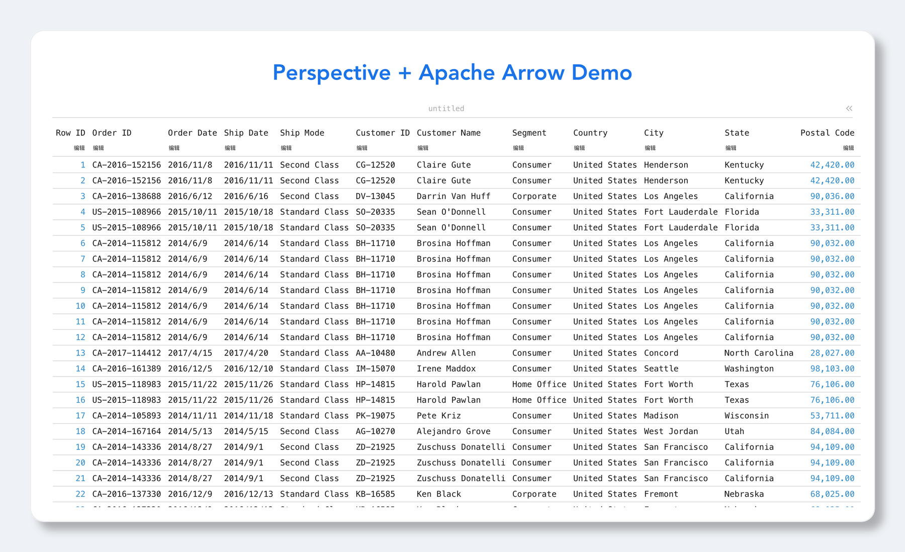

# perspective-vue

基于 Vue 2 的 [Perspective](https://perspective-dev.github.io/guide/perspective.html) + Apache Arrow 数据可视化 Demo。通过 Web Components 形式集成 `perspective-viewer`，并支持 Datagrid / Charts 等多种插件切换，且每个插件的配置会被独立保存与还原。

**在线 Demo**：<https://ehehaye.github.io/perspective-vue/>



## 技术栈

- Vue `^2.6.14` + Vue CLI `~5.0.0`
- Perspective（`@perspective-dev/client`、`viewer`、`viewer-charts`、`viewer-datagrid`）
- Apache Arrow 数据源（默认通过 CDN 拉取 `superstore-arrow`）
- 包管理器：pnpm

## 项目结构

```
.
├── docs/
│   └── screenshot.png           # 项目运行截图
├── public/
│   ├── libs/                    # Perspective 各模块的构建产物（基于 NPM 包结构同步）
│   │   └── @perspective-dev/
│   │       ├── client/          # perspective.js
│   │       ├── server/          # perspective-server wasm
│   │       ├── viewer/          # perspective-viewer.js + wasm + css
│   │       ├── viewer-charts/   # perspective-viewer-charts.js
│   │       └── viewer-datagrid/ # perspective-viewer-datagrid.js
│   └── index.html
├── src/
│   ├── components/
│   │   └── PerspectiveWrapper.vue   # 核心组件：加载模块、加载 Arrow、绑定 viewer
│   ├── utils/
│   │   └── index.js                 # importStyle：动态注入 <link rel="stylesheet">
│   ├── App.vue
│   └── main.js
├── vue.config.js
└── package.json
```

## 快速开始

```bash
# 安装依赖
pnpm install

# 启动开发服务（默认 http://localhost:8080）
pnpm run serve

# 生产构建
pnpm run build

# 代码检查与修复
pnpm run lint
```

## 部署

项目通过 GitHub Actions 自动部署到 GitHub Pages，推送到 `main` 分支即会触发构建：

- 工作流配置：[.github/workflows/deploy.yml](.github/workflows/deploy.yml)
- 在线地址：<https://ehehaye.github.io/perspective-vue/>

仓库需在 **Settings → Pages → Build and deployment → Source** 中选择 **GitHub Actions**（Fork 后部署时同样需要）。

## 工作原理

### 1. 模块加载

`PerspectiveWrapper.vue` 通过 `import(/* webpackIgnore: true */ ...)` 在运行时从 `public/libs` 中加载 Perspective 的 JS / WASM 资源，避免被打包工具处理。

默认使用本地 `public/libs`（`CDN_PREFIX` 由 `process.env.BASE_URL` 拼接，自动适配部署子路径），如需切换为 CDN，把组件中的注释行打开即可：

```js
const CDN_PREFIX = `${process.env.BASE_URL}libs`;
// const CDN_PREFIX = "https://cdn.jsdelivr.net/npm";
```

样式通过 [src/utils/index.js](src/utils/index.js) 中的 `importStyle` 动态注入 `pro.css` 与 `intl/custom.css`。

### 2. 数据加载

组件 `mounted` 阶段并行执行：
1. 加载 Perspective 模块并创建 worker
2. 通过 `fetch` 拉取 Arrow 二进制（默认 `https://cdn.jsdelivr.net/npm/superstore-arrow/superstore.arrow`）

随后调用 `worker.table(buf, { name })` 注册命名表，并通过 `viewer.load(worker)` 与 `viewer.restore()` 应用初始插件配置。

### 3. 插件配置独立保存

监听 `perspective-config-update` 事件，当用户在不同插件（Datagrid / Charts 等）间切换时：
- 每个插件最近一次的配置会被存入 `pluginConfigMap`
- 切回某个插件时，自动 `restore` 其上次的配置

### 4. 资源清理

组件销毁时（`beforeDestroy`）移除事件监听并调用 `viewer.delete()`，遵循 [Perspective 资源释放规范](https://perspective-dev.github.io/guide/how_to/javascript/deleting.html)，避免内存泄漏。

## 组件 API

`PerspectiveWrapper` 支持以下 props：

| Prop           | 类型     | 默认值                                                            | 说明                          |
| -------------- | -------- | ----------------------------------------------------------------- | ----------------------------- |
| `defaultPlugin`| `String` | `"Datagrid"`                                                      | 初始化时使用的 viewer 插件    |
| `arrow`        | `String` | `https://cdn.jsdelivr.net/npm/superstore-arrow/superstore.arrow`  | Arrow 数据文件的 URL          |
| `title`        | `String` | `""`                                                              | viewer 标题，留空时取自 `arrow` 的文件名（如 `superstore`） |

使用示例：

```vue
<PerspectiveWrapper
  defaultPlugin="Datagrid"
  arrow="https://cdn.jsdelivr.net/npm/superstore-arrow/superstore.arrow"
  title="Superstore"
/>
```

## 配置参考

- Vue CLI 配置见 [vue.config.js](vue.config.js)
- ESLint 规则继承 `plugin:vue/essential` + `eslint:recommended`
- `main.js` 中通过 `Vue.config.ignoredElements` 告知 Vue 忽略 `perspective-viewer` 等 custom element

## 相关链接

- [Perspective 官方文档](https://perspective-dev.github.io/guide/perspective.html)
- [Perspective GitHub](https://github.com/perspective-dev/perspective)
- [Vue CLI 配置参考](https://cli.vuejs.org/zh/guide/)
